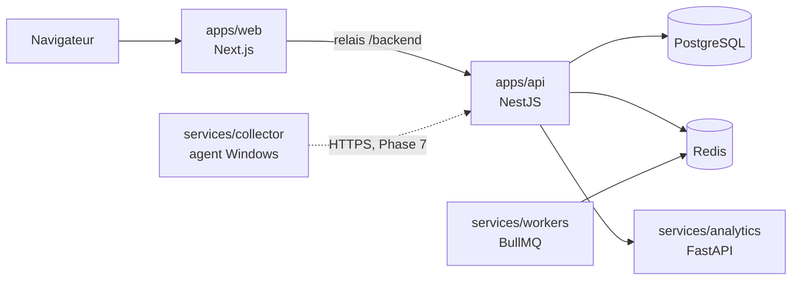

# Architecture

## Vue d'ensemble

Seul ce qui figure en trait plein existe aujourd'hui.

## Décisions

### Monorepo pnpm et Turborepo

Les paquets TypeScript sont en ESM, car NestJS 12 l'impose. Les services Python ont un `package.json` minimal : Turborepo les pilote ainsi comme les autres paquets, et `scripts/py.mjs` gère leur environnement virtuel.

### `packages/database`, ajouté à la structure du cahier des charges

L'API et les workers accèdent tous deux à la base. Le schéma Prisma, les migrations et le client sont donc dans un paquet partagé plutôt que dans `apps/api`.

### Relais `/backend` plutôt que réécritures Next.js

Les réécritures de `next.config` sont figées au build. Le relais lit `API_INTERNAL_URL` à l'exécution : une même image web sert en Cloud et en On-Premise. Le navigateur reste sur la même origine, ce qui prépare les cookies de session de la Phase 2.

### Configuration validée au démarrage

Les variables d'environnement sont validées par des schémas Zod de `packages/validation`. Un service mal configuré refuse de démarrer, et ses messages d'erreur ne reproduisent jamais les valeurs, qui peuvent contenir des secrets.

### Santé réelle plutôt que déclarative

`GET /health` interroge réellement chaque dépendance à chaque appel :

| Dépendance | Vérification                                                   | Critique |
| ---------- | -------------------------------------------------------------- | -------- |
| PostgreSQL | `SELECT 1`                                                     | Oui      |
| Redis      | `PING`                                                         | Oui      |
| Analytics  | `GET /health`                                                  | Non      |
| Workers    | Présence du heartbeat publié par une tâche BullMQ, TTL de 90 s | Non      |

Une dépendance critique absente donne `error` et HTTP 503. Une dépendance secondaire absente donne `degraded` et HTTP 200. Les messages publics ne contiennent jamais d'erreur de pilote, qui pourrait révéler un hôte ou une URL de connexion.

### Heartbeat des workers par tâche BullMQ

Le heartbeat est publié par une tâche planifiée et traitée dans la file `system`. Sa présence prouve toute la chaîne : Redis, le planificateur et le traitement. La clé expire seule, donc un worker arrêté est détecté sans signal d'arrêt.

### Versions fixées

| Paquet     | Version | Raison                                                                                    |
| ---------- | ------- | ----------------------------------------------------------------------------------------- |
| Node.js    | 24      | Prisma 7.10 ne supporte que les versions 20, 22 et 24                                     |
| TypeScript | 5.9     | `typescript-eslint` exige moins de 6.1 et `@nestjs/swagger` moins de 7                    |
| Prisma     | 7.10    | Le tag `latest` pointe sur une RC 8, et Better Auth accepte au plus Prisma 7              |
| pnpm       | 10      | Le paquet pnpm 12 installé par npm laisse un exécutable inutilisable sur cette machine    |
| ESLint     | 9       | Fonctionne avec toute la chaîne, mais npm la signale obsolète : passage à la 10 à prévoir |

## Authentification

Better Auth est monté dans l'API sur `/api/auth/*`, avant le parseur JSON de NestJS, car il lit lui-même le corps de ses requêtes. Le navigateur y accède par le relais `/backend` : la session est un cookie `HttpOnly` de première partie (`arksen.session_token`), jamais lisible par JavaScript.

| Règle                                    | Mise en œuvre                                                                              |
| ---------------------------------------- | ------------------------------------------------------------------------------------------ |
| Pas d'inscription libre                  | `disableSignUp` : les comptes sont créés par un administrateur                             |
| Mots de passe                            | 12 à 128 caractères (NIST SP 800-63B), hachés en scrypt par Better Auth                    |
| Durée de session                         | 12 heures, prolongée à l'usage par tranches d'une heure                                    |
| Force brute                              | 5 tentatives de connexion par minute et par adresse IP                                     |
| Origine                                  | Seule `PUBLIC_WEB_URL` est acceptée pour les requêtes d'authentification                   |
| Compte désactivé ou entreprise suspendue | Création de session refusée, sessions existantes supprimées, vérification à chaque requête |
| Champs sensibles                         | `role`, `status` et `tenantId` ne peuvent jamais être fournis par le client                |

Le premier Super Administrateur est créé au démarrage de l'API à partir de `SUPER_ADMIN_EMAIL` et `SUPER_ADMIN_PASSWORD`, uniquement si aucun n'existe.

## Contrôle d'accès

Deux gardes globaux s'appliquent à chaque route, sauf celles marquées `@Public()` (`/health`, `/api/v1/system/info`) :

1. **`AuthenticationGuard`** vérifie la session, puis relit le compte et son entreprise en base. Une désactivation prend donc effet à la requête suivante.
2. **`AuthorizationGuard`** applique deux règles :
   - **Périmètre :** sur toute route portant `:tenantId`, un utilisateur d'entreprise n'accède qu'à la sienne. Une autre entreprise répond 404, pour ne pas révéler son existence.
   - **Permissions :** le rôle doit détenir toutes celles déclarées par `@RequirePermissions()`.

La matrice des rôles est définie dans le code (`packages/shared-types/src/access.ts`), et non en base : une politique de sécurité modifiable à l'exécution serait une surface d'attaque sans besoin métier identifié. Chaque phase y ajoutera les permissions de ses modules.

| Permission                  | Super Admin | Admin client | Resp. impression | Technicien | Gest. stock | Utilisateur |
| --------------------------- | :---------: | :----------: | :--------------: | :--------: | :---------: | :---------: |
| `platform:tenants:manage`   |     Oui     |              |                  |            |             |             |
| `platform:audit:read`       |     Oui     |              |                  |            |             |             |
| `tenant:read`               |     Oui     |     Oui      |       Oui        |    Oui     |     Oui     |     Oui     |
| `users:read`                |     Oui     |     Oui      |       Oui        |            |             |             |
| `users:manage`              |     Oui     |     Oui      |                  |            |             |             |
| `audit:read`                |     Oui     |     Oui      |                  |            |             |             |
| `platform:catalog:manage`   |     Oui     |              |                  |            |             |             |
| `sites:read`                |     Oui     |     Oui      |       Oui        |    Oui     |     Oui     |     Oui     |
| `sites:manage`              |     Oui     |     Oui      |       Oui        |            |             |             |
| `printers:read`             |     Oui     |     Oui      |       Oui        |    Oui     |     Oui     |     Oui     |
| `printers:manage`           |     Oui     |     Oui      |       Oui        |    Oui     |             |             |
| `printers:network:manage`   |     Oui     |     Oui      |       Oui        |    Oui     |             |             |
| `printer-models:manage`     |     Oui     |     Oui      |       Oui        |            |             |             |
| `meters:read`               |     Oui     |     Oui      |       Oui        |    Oui     |     Oui     |     Oui     |
| `meters:manage`             |     Oui     |     Oui      |       Oui        |    Oui     |             |             |
| `consumption:read`          |     Oui     |     Oui      |       Oui        |    Oui     |     Oui     |             |
| `consumption:manage`        |     Oui     |     Oui      |       Oui        |    Oui     |             |             |
| `print-jobs:read`           |     Oui     |     Oui      |       Oui        |    Oui     |     Oui     |             |
| `print-jobs:manage`         |     Oui     |     Oui      |       Oui        |    Oui     |             |             |
| `agents:read`               |     Oui     |     Oui      |       Oui        |    Oui     |             |             |
| `agents:manage`             |     Oui     |     Oui      |       Oui        |    Oui     |             |             |
| `stocks:read`               |     Oui     |     Oui      |       Oui        |    Oui     |     Oui     |             |
| `stocks:manage`             |     Oui     |     Oui      |       Oui        |            |     Oui     |             |
| `toner-replacements:manage` |     Oui     |     Oui      |       Oui        |    Oui     |     Oui     |             |
| `alerts:read`               |     Oui     |     Oui      |       Oui        |    Oui     |     Oui     |             |
| `alerts:manage`             |     Oui     |     Oui      |       Oui        |    Oui     |     Oui     |             |
| `costs:read`                |     Oui     |     Oui      |       Oui        |            |     Oui     |             |
| `costs:manage`              |     Oui     |     Oui      |       Oui        |            |             |             |
| `contracts:read`            |     Oui     |     Oui      |       Oui        |            |             |             |
| `contracts:manage`          |     Oui     |     Oui      |       Oui        |            |             |             |
| `interventions:read`        |     Oui     |     Oui      |       Oui        |    Oui     |     Oui     |     Oui     |
| `interventions:report`      |     Oui     |     Oui      |       Oui        |    Oui     |     Oui     |     Oui     |
| `interventions:manage`      |     Oui     |     Oui      |       Oui        |    Oui     |             |             |

Un administrateur client ne peut ni attribuer le rôle Super Administrateur, ni modifier son propre rôle ou statut.

## Isolation multi-tenant

L'isolation repose sur trois couches indépendantes : une erreur dans l'une ne suffit pas à exposer les données d'une autre entreprise.

1. **API :** l'entreprise vient de la session ou d'un paramètre d'URL comparé à la session, jamais du corps de la requête. Un `tenantId` glissé dans un formulaire est ignoré.
2. **Requêtes :** chaque lecture filtre explicitement sur `tenantId`.
3. **PostgreSQL :** l'API se connecte avec deux rôles distincts, jamais avec le propriétaire de la base.

| Rôle PostgreSQL | Attribut      | Usage                                                                                           |
| --------------- | ------------- | ----------------------------------------------------------------------------------------------- |
| `arksen`        | propriétaire  | Migrations uniquement                                                                           |
| `arksen_app`    | `NOBYPASSRLS` | Données métier, toujours via `withTenant()`. Aucun droit sur les sessions ni les mots de passe  |
| `arksen_system` | `BYPASSRLS`   | Authentification, journal d'audit, opérations explicitement transverses du Super Administrateur |

`withTenant(prisma, tenantId, work)` ouvre une transaction et y définit `app.tenant_id` avec `SET LOCAL`. Les politiques RLS ne laissent voir et écrire que les lignes de cette entreprise. Sans contexte, le rôle métier ne voit **aucune** ligne. Le réglage disparaît avec la transaction : une connexion rendue au pool ne garde jamais le contexte d'une autre entreprise.

**Règle pour toute nouvelle table d'entreprise :** colonne `tenant_id`, politique `tenant_isolation` dans la migration, accès par `withTenant()`. Un test de bout en bout échoue si une table portant `tenant_id` n'a pas le RLS activé.

## Journal d'audit

Les événements sensibles sont enregistrés dans `audit_logs` : connexions réussies, échouées ou refusées, changements de mot de passe, créations et modifications d'entreprises et d'utilisateurs. Un déclencheur PostgreSQL interdit toute modification ou suppression, y compris pour les rôles applicatifs. Un échec d'écriture du journal est journalisé, mais n'interrompt jamais l'action de l'utilisateur.

Le journal est conservé trois ans par défaut, un an au moins. Seule la fonction `purge_audit_logs`, exécutable par le seul rôle `arksen_system`, peut supprimer des entrées, et le déclencheur refuse toute suppression d'une entrée de moins d'un an. Voir [security.md](security.md).

## Adresse IP des clients

Express résout l'adresse du client à partir du pair TCP et de `X-Forwarded-For` : seuls les proxys des réseaux privés et de la boucle locale sont crus, et la chaîne est lue de droite à gauche jusqu'au premier saut non fiable. Cette adresse sert au journal d'audit, et elle est recopiée dans l'en-tête interne `x-arksen-client-ip` (toujours écrasé), seul lu par Better Auth pour limiter les tentatives de connexion.

Better Auth ne voit pas le pair TCP. Lui faire relire `X-Forwarded-For` avec une liste de proxys de confiance rejetterait l'adresse privée d'un poste du réseau local (On-Premise) : l'adresse serait absente du journal, et tous les postes partageraient un seul compteur de tentatives.

En développement, sans proxy frontal, un poste du réseau local peut fixer son propre `X-Forwarded-For`. En production, Nginx remplace cet en-tête par l'adresse réelle du client (`proxy_set_header X-Forwarded-For $remote_addr`), et ni le frontend ni l'API ne sont joignables sans lui.

## Parc machines

| Table                 | Contenu                                       | Isolation                                                                               |
| --------------------- | --------------------------------------------- | --------------------------------------------------------------------------------------- |
| `sites`               | Implantations d'une entreprise                | RLS `tenant_isolation`                                                                  |
| `printer_models`      | Fiches techniques                             | Lecture : catalogue Arksen et fiches de l'entreprise ; écriture : les siennes seulement |
| `printers`            | Machines, statut d'exploitation, connectivité | RLS, plus clé composite vers le site et déclencheur sur le modèle                       |
| `printer_connections` | Adresse réseau et accès SNMP                  | RLS, plus clé composite vers la machine                                                 |

**Catalogue Arksen.** Une fiche sans `tenant_id` appartient au catalogue partagé : toutes les entreprises la lisent, seule la plateforme la modifie (permission `platform:catalog:manage`, rôle `arksen_system`). Une entreprise crée ses propres fiches pour les modèles absents du catalogue.

**Intégrité entre entreprises, dans la base elle-même.** Une machine référence son site par la paire `(site_id, tenant_id)` : la base refuse qu'elle pointe vers le site d'une autre entreprise, même pour le rôle système. Un déclencheur refuse de même un modèle privé d'une autre entreprise. Les tests de bout en bout le vérifient directement en SQL.

**Statut et connectivité sont distincts.** Le statut (en service, en maintenance, hors service, retirée) est déclaré par les utilisateurs. La connectivité (en ligne, hors ligne) sera mesurée par l'agent de collecte en Phase 7 : d'ici là, elle vaut « non mesurée » et n'est jamais déduite ni simulée.

**Machines retirées.** Elles ne sont jamais supprimées, pour garder leur historique (compteurs, consommations des phases suivantes). Elles sortent du parc actif et des indicateurs, mais restent consultables par le filtre de statut. Un site ou une fiche encore utilisé ne peut pas être supprimé.

### Secrets SNMP

La communauté SNMPv1/v2c et les mots de passe SNMPv3 sont chiffrés en AES-256-GCM avant d'être écrits, avec la clé `CREDENTIALS_ENCRYPTION_KEY`. Chaque valeur est liée à sa machine et à son champ par les données authentifiées : recopiée ailleurs, elle devient indéchiffrable.

Ils sont en écriture seule. L'API n'en renvoie que la présence (`hasCommunity`, `hasAuthPassword`, `hasPrivPassword`). Un secret absent de la requête est conservé, `null` l'efface, une valeur le remplace. Le journal d'audit indique quels secrets ont changé, jamais leur valeur.

La clé doit être sauvegardée avec la base : sans elle, les secrets sont perdus et doivent être ressaisis. Sa rotation, qui demande de rechiffrer les secrets, est à outiller avant la mise en production.

## Compteurs

Un relevé (`meter_readings`) photographie les compteurs noir et blanc et couleur d'une machine à un instant donné. Le total est toujours égal à leur somme, ce que la base vérifie par une contrainte. Une machine noir et blanc n'a pas de compteur couleur, et une machine couleur doit avoir les deux.

**Sources.** En Phase 4, les relevés sont saisis à la main ou importés depuis un fichier CSV. L'agent de collecte (Phase 7) en enverra avec la source `AGENT`.

**Idempotence.** Une machine n'a qu'un relevé par instant (contrainte unique `printer_id, read_at`), et un identifiant externe facultatif est unique par entreprise. Rejouer un import, ou plus tard une synchronisation de l'agent, ne crée donc jamais de doublon.

**Volumes.** Ils se déduisent des écarts entre relevés successifs. Le volume d'un intervalle est réparti à parts égales dans le temps, puis regroupé par jour ou par mois (jours UTC). Chaque volume porte sa **couverture** : la part de la période encadrée par des relevés. Un jour sans relevé de part et d'autre a un volume inconnu, jamais nul. Les arrondis ne se font qu'à la fin des calculs.

**Remise à zéro.** Quand un compteur est remplacé, le relevé est marqué « remise à zéro » : aucun volume n'est calculé avec le précédent, et aucune anomalie n'est signalée.

**Anomalies**, calculées à la lecture, sans être stockées :

| Anomalie                       | Règle                                                                                    | Gravité     |
| ------------------------------ | ---------------------------------------------------------------------------------------- | ----------- |
| Compteur en baisse             | Un canal est inférieur au relevé précédent, sans remise à zéro déclarée                  | Critique    |
| Pic de volume                  | Débit supérieur à 4 fois la médiane des 10 intervalles précédents, et au moins 300 pages | Attention   |
| Au-delà du volume constructeur | Débit quotidien supérieur au volume mensuel maximal de la fiche technique, divisé par 30 | Attention   |
| Aucune impression              | Machine en service sans aucune page depuis au moins 30 jours                             | Information |
| Relevé manquant                | Machine en service sans relevé depuis plus de 35 jours, ou jamais relevée                | Information |

Les seuils sont réunis dans `apps/api/src/meters/meter-analysis.ts`, un module sans accès à la base, testé isolément.

**Comparaison des périodes.** Les volumes d'une période se comparent à la période précédente de même durée, ou à la même période un an plus tôt.

## Moteur de consommation CMJN

Le moteur est écrit en Python, dans `services/analytics` (`cmyk.py` pour les formules, `cmyk_api.py` pour le point d'entrée `POST /v1/cmyk/estimate`). Il ne lit ni n'écrit aucune donnée : l'API rassemble tout ce qu'il calcule (toners, prix, profils, mesures, pages tirées des compteurs) et lui envoie un lot de machines. Il servira aussi l'estimation du toner d'un fichier PDF en Phase 6.

**Formules**, calculées canal par canal :

| Grandeur                  | Calcul                                                                                         |
| ------------------------- | ---------------------------------------------------------------------------------------------- |
| Consommation de référence | masse du toner ÷ rendement constructeur, en grammes par page                                   |
| Consommation théorique    | référence × (aplat ÷ couverture de référence) × pages × facteur de format × facteur de support |
| Consommation estimée      | théorique × coefficient de calibration                                                         |
| Coût                      | prix de la cartouche ÷ masse du toner × grammes                                                |
| Écart                     | réel − théorique, en grammes et rapporté au théorique                                          |
| Taux de surconsommation   | l'écart rapporté au théorique quand il est positif, zéro sinon                                 |

- **Pages concernées :** le noir s'imprime sur toutes les pages, le cyan, le magenta et le jaune sur les pages couleur seulement.
- **Couverture de référence :** 5 % par défaut, celle des normes de rendement ISO/IEC 19752 et 19798. Elle se règle par toner.
- **Facteur de format :** la surface rapportée à l'A4 (A3 : 2 ; SRA3 : 320 × 450 ÷ 210 × 297, soit 2,31). Si les compteurs comptent déjà un A3 pour deux pages, le format reste A4.
- **Facteur de support :** 1 pour un papier standard. Aucune valeur par type de support n'est inventée : c'est un réglage de la machine.

**Aplat.** En Phase 5, l'aplat de chaque canal est un **aplat moyen supposé**, réglé par machine (5 % par défaut). L'analyse des fichiers (Phase 6) mesurera l'aplat réel des travaux.

**Trois natures de valeur**, jamais confondues :

| Valeur    | Origine                                                                                                   |
| --------- | --------------------------------------------------------------------------------------------------------- |
| Théorique | Le moteur, d'après le rendement constructeur, l'aplat et les pages                                        |
| Estimée   | La théorique corrigée par la calibration                                                                  |
| Réelle    | Une pesée (mesurée), ou des cartouches vidées multipliées par leur masse (estimée). Jamais un niveau SNMP |

**Calibration progressive.** Pour chaque canal d'une machine :

1. un coefficient saisi à la main l'emporte ;
2. sinon, les consommations réelles des autres machines du même modèle donnent un coefficient de modèle ;
3. les consommations réelles de la machine donnent son coefficient, lissé vers celui du modèle (ou vers 1 sans mesure du modèle).

Le lissage : k = (Σ réel + m × k_ref × T̄) / (Σ théorique + m × T̄), où T̄ est le théorique moyen d'une mesure et m = 2. Une seule mesure ne fait donc qu'une partie du chemin. La confiance est faible jusqu'à 2 mesures, moyenne jusqu'à 5, élevée au-delà.

**Toners et prix.** Les toners d'un modèle suivent sa fiche technique : catalogue Arksen ou fiche d'entreprise, avec les mêmes politiques RLS et un déclencheur qui garantit le même périmètre. Les prix d'achat sont propres à chaque entreprise, dans sa devise (`tenants.currency`, XOF par défaut). Un déclencheur refuse le prix d'un toner privé d'une autre entreprise.

**Disponibilité.** Si le moteur ne répond pas, les pages de consommation affichent « Le moteur de calcul est indisponible » (HTTP 503). Il n'est joignable que par l'API, sur le réseau interne ; son port publié en développement disparaîtra en Phase 10.

## Analyse PDF

**Chaîne.** Le navigateur envoie le fichier en multipart à l'API (`POST /tenants/:tenantId/print-jobs`, 50 Mo au plus), qui le transmet au service d'analyse (`POST /v1/pdf/analyze`, sans état). L'API enregistre les mesures (`print_jobs`, `print_job_pages`) et l'empreinte SHA-256 du fichier, puis l'oublie : **le PDF n'est pas conservé**. L'analyse est synchrone : 500 pages au plus, à 72 ppp par défaut.

**Bibliothèques.** PDFium (via `pypdfium2`, licences BSD et Apache 2.0) rend les pages ; numpy calcule ; Pillow et LittleCMS (licences HPND et MIT) appliquent un profil ICC de sortie. PyMuPDF et Ghostscript, envisagés au départ, ont été écartés : ils sont sous AGPL ou sous licence commerciale.

**Méthode de mesure**, documentée et reproductible :

1. **Rendu.** Chaque page est rendue en sRGB sur fond blanc. PDFium interprète les espaces de couleur du document (RVB, CMJN, profils ICC intégrés, couleurs spéciales par leur espace de substitution) ainsi que les transparences et les modes de fusion : la page mesurée est celle qui serait vue.
2. **Séparation en CMJN.**
   - **Avec un profil ICC de sortie** (`ANALYTICS_CMYK_ICC_PROFILE`, chemin d'un fichier `.icc` ou `.icm` dans le conteneur), la conversion sRGB → CMJN se fait avec LittleCMS, en intention perceptuelle. C'est la méthode à privilégier : le profil de la machine ou de la norme visée (FOGRA, GRACoL…).
   - **Sans profil**, une séparation de référence est appliquée : génération du noir à 100 %, K = 1 − max(R, V, B), puis C = (1 − R − K) / (1 − K), et de même pour M et J. Elle est déterministe mais ne reproduit ni l'engraissement ni la limite d'encrage d'une vraie machine ; la calibration de chaque machine corrige l'écart.
   - La méthode retenue est enregistrée avec chaque analyse (`pdfium-srgb/separation-reference-gcr100` ou `pdfium-srgb/icc:<profil>`).
3. **Couverture.** La couverture d'une encre est la **moyenne de sa valeur de teinte sur toute la surface de la page**, en %. Une demi-page en aplat plein vaut 50 % ; une page entière à 20 % de teinte vaut aussi 20 %. Ce n'est jamais une proportion de pixels colorés. La couverture cumulée est la somme des quatre encres (jusqu'à 400 %).
4. **Niveaux de gris.** Pour une machine noir et blanc, la couverture de noir d'une page est la moyenne de 1 − luminance (Rec. 709).
5. **Page couleur** : C + M + J > 0,05 %.
6. **Formats.** A5, A4, A3, SRA3, Letter, Legal et Tabloid, à ± 3 mm, sinon « Personnalisé » ; orientation portrait, paysage ou carrée. Le facteur de surface rapporte la page à l'A4.
7. **Moyenne du document**, pondérée par la surface des pages.

**Rapport de préproduction.** Pour une machine et un nombre d'exemplaires, l'API ramène le travail à des pages A4 équivalentes : pages = Σ surfaces × exemplaires, pages couleur = Σ surfaces des pages couleur × exemplaires. La couverture de chaque encre est la moyenne pondérée par la surface (le noir sur toutes les pages, les couleurs sur les pages couleur ; le gris sur une machine noir et blanc). Le moteur de consommation calcule alors le toner, le coût et la calibration, comme pour le simulateur. Le toner d'un exemplaire est réparti entre les pages au prorata de leur couverture × surface.

**Isolation.** Les deux tables ont la RLS `tenant_isolation` ; les pages ont une clé étrangère composite (`job_id`, `tenant_id`) ; un déclencheur refuse la machine d'une autre entreprise.

## Collecte SNMP

**Agent.** L'agent Windows `services/collector` interroge les imprimantes en SNMP. Il range ses relevés dans une outbox SQLite et les synchronise par le relais du frontend. Installation, données collectées, stockage local et protocole : [collector.md](collector.md).

**Enregistrement et authentification.**

- Un administrateur déclare l'agent (`collector_agents`), éventuellement limité à un site. Il obtient un code à usage unique, valable 24 heures.
- L'agent échange ce code contre un jeton de 256 bits (`POST /agent/v1/enroll`).
- Le serveur ne garde que les empreintes SHA-256 du code et du jeton. Une contrainte de la table garantit qu'un agent actif a un jeton et qu'un agent révoqué n'en a plus.
- Les routes de l'agent sont publiques pour la garde de session, mais protégées par `AgentGuard`. Celle-ci retrouve l'agent par l'empreinte du jeton et revérifie à chaque requête que l'agent et son entreprise sont actifs. L'entreprise et le site viennent de l'agent, jamais de la requête.

**Configuration.** `GET /agent/v1/config` renvoie à l'agent :

- les machines de son périmètre qui ont une adresse et ne sont pas retirées ;
- leurs secrets SNMP, déchiffrés pour l'agent seulement ;
- l'OID du compteur total (Printer-MIB) et ceux des compteurs noir et couleur, propres au constructeur et renseignés sur la fiche technique (`printer_models.snmp_black_counter_oid`, `snmp_color_counter_oid`).

**Synchronisation idempotente.** `POST /agent/v1/events` reçoit un lot de l'outbox de l'agent. Chaque événement est traité dans sa propre transaction et journalisé dans `agent_events`, sous l'identifiant que lui a donné l'agent :

- un identifiant déjà connu est acquitté `duplicate`, sans second traitement ;
- un événement invalide, hors périmètre ou daté dans le futur est rejeté avec sa raison, sans bloquer les autres ;
- chaque lot est inscrit au journal des synchronisations (`agent_sync_logs`).

Effets des événements :

| Événement           | Effet                                                                                                                                                                 |
| ------------------- | --------------------------------------------------------------------------------------------------------------------------------------------------------------------- |
| `meter.reading`     | Relevé `meter_readings` de source `AGENT`, `external_id` = identifiant de l'événement. Une machine couleur exige noir et couleur                                      |
| `printer.status`    | Dernier état `printer_states` (statut, alertes, niveaux `snmp_level`), connectivité et dernière réponse de la machine. Un état plus ancien ne remplace pas le dernier |
| `device.discovered` | `discovered_devices`, rattaché à la machine de même numéro de série                                                                                                   |

**Interface.** La page **Agents de collecte** (`/collecte`) présente :

- les agents, avec leur état et leur activité des dernières 24 heures ;
- les codes d'enregistrement, montrés une seule fois ;
- les révocations ;
- les équipements découverts, qu'on peut associer à une machine ou ignorer ;
- le journal des synchronisations et les événements rejetés.

La fiche machine affiche le panneau **État SNMP**. La fiche technique reçoit les OID des compteurs.

**Isolation.** Les cinq tables de la collecte sont sous RLS. Leurs clés étrangères composites (`agent_id`, `tenant_id`) et (`printer_id`, `tenant_id`) empêchent tout rattachement à une autre entreprise.

## Toners, stocks et alertes

**Articles et registre.** Un article (`toner_stocks`) suit une référence de cartouche sur un site, avec un seuil minimum et un délai de réapprovisionnement. Les références sont celles des fiches techniques, comparées sans tenir compte de la casse : une cartouche commune à plusieurs modèles n'a qu'un article par site.

La quantité n'est jamais écrite directement. Elle résulte du registre `stock_movements`, et deux déclencheurs garantissent les invariants :

- `stock_movements_apply` verrouille l'article, calcule le solde après le mouvement et refuse un stock négatif (« Stock insuffisant »). Deux sorties simultanées ne peuvent donc pas vider deux fois le même stock.
- `stock_movements_immutable` refuse toute modification ou suppression du registre, même au rôle système ; `toner_stocks_quantity_guard` refuse une quantité modifiée hors du registre. Une erreur se corrige par un inventaire.

| Mouvement                    | Signe | Origine                                                    |
| ---------------------------- | ----- | ---------------------------------------------------------- |
| Réception                    | +     | Saisie, avec coût unitaire et bon de livraison facultatifs |
| Sortie                       | −     | Saisie (remise, retour, casse)                             |
| Inventaire                   | ±     | Quantité comptée : le mouvement est l'écart avec le stock  |
| Transfert sortant et entrant | − / + | Deux mouvements liés par `transfer_id`                     |
| Installation                 | −     | Remplacement de toner pris dans le stock                   |
| Annulation                   | +     | Annulation de ce remplacement                              |

La valeur du stock suit le dernier coût de réception, à défaut le prix du toner.

**Remplacements et rendement réel.** Un remplacement (`toner_replacements`) enregistre le compteur de la machine au moment du remplacement : le compteur noir pour le noir, le compteur couleur pour le cyan, le magenta et le jaune. L'écart avec le remplacement précédent du même canal donne le **rendement réel** de la cartouche retirée, comparé au rendement constructeur. Un remplacement erroné est annulé, pas supprimé, et sa cartouche revient dans son stock.

**Historique des niveaux SNMP.** À chaque état reçu d'un agent, le niveau de chaque cartouche entre dans `supply_level_readings` s'il a changé ou si le dernier point date de plus de six heures. Cet historique sert à deux choses :

- **Épuisement prévu** de chaque cartouche (fiche machine) : pente par moindres carrés des niveaux depuis la dernière remontée, sur 60 jours.
- **Remplacements à confirmer** : une remontée d'au moins 30 points jusqu'à 70 % ou plus, sans remplacement enregistré à moins de 3 jours. Rien n'est enregistré sans un utilisateur.

**Prévisions de rupture.** Le rythme de consommation d'un article vient du moteur CMJN : sur 90 jours, la consommation estimée (pages relevées, aplat, calibration) des machines du site équipées de la référence, divisée par la masse de toner d'une cartouche. Sans estimation, le rythme vient de l'historique des installations depuis ce stock. On en tire :

- la couverture en jours et la date de rupture ;
- une quantité à commander, qui couvre le délai de réapprovisionnement et 30 jours, et au moins le seuil plus un.

**Alertes.** Une alerte (`alerts`) correspond à une condition, identifiée par une clé de déduplication. Un index unique partiel garantit une seule alerte active par condition : tant que la condition dure, l'alerte se rafraîchit (`INSERT … ON CONFLICT`) ; dès qu'elle disparaît, l'alerte se résout d'elle-même. Un utilisateur peut aussi la prendre en compte ou la clôturer.

| Alerte               | Gravité       | Condition                                                  | Évaluée                                 |
| -------------------- | ------------- | ---------------------------------------------------------- | --------------------------------------- |
| Rupture de stock     | Critique      | Seuil positif et stock nul                                 | À chaque mouvement, dans sa transaction |
| Stock sous le seuil  | Avertissement | Stock au seuil ou en dessous                               | À chaque mouvement, dans sa transaction |
| Rupture prévue       | Avertissement | Couverture plus courte que le délai de réapprovisionnement | Toutes les heures, ou à la demande      |
| Toner bientôt épuisé | Avertissement | Niveau SNMP de 10 % ou moins                               | À chaque état reçu d'un agent           |
| Toner épuisé         | Critique      | Niveau SNMP de 2 % ou moins                                | À chaque état reçu d'un agent           |

Les alertes de niveau se résolvent aussi quand un remplacement est enregistré. L'évaluation horaire des ruptures prévues tourne dans l'API ; un verrou Redis la confie à une seule instance.

## Coûts, contrats et maintenance

**Papier.** Un papier (`paper_types`) a un format, un grammage, un nombre de feuilles par rame et un prix de rame. Ses stocks par site (`paper_stocks`, en rames) suivent le même registre immuable que les toners (`paper_movements`), avec les mêmes déclencheurs : solde sous verrou et stock jamais négatif. Les alertes de papier sont `PAPER_LOW` et `PAPER_OUT`. La couverture d'un stock suit les pages des machines du site réglées sur ce papier.

**Coûts d'impression et coût copie.** Pour chaque machine et pour une période (`GET /costs`), les coûts additionnés sont les suivants :

| Poste         | Source                                                                                        |
| ------------- | --------------------------------------------------------------------------------------------- |
| Toner         | Consommation estimée par le moteur CMJN (pages relevées, aplat, calibration), au prix d'achat |
| Papier        | Feuilles = pages × (1 − recto verso / 2), au prix de la feuille du papier de la machine       |
| Interventions | Main-d'œuvre et pièces des interventions terminées sur la période                             |
| Coûts fixes   | Location ou amortissement mensuel, au prorata des jours                                       |

Le papier, la part de recto verso et les coûts fixes se règlent par machine (`printer_cost_settings`). Le coût copie se calcule ainsi :

- une page noir et blanc porte le toner noir et sa part des coûts communs (papier, interventions, coûts fixes) ;
- une page couleur y ajoute les toners cyan, magenta et jaune, répartis sur les seules pages couleur.

Un coût inconnu reste inconnu : un toner sans prix ou un papier non renseigné apparaît comme une lacune, jamais comme zéro.

**Contrats et relevés de facturation.** Un contrat au coût copie (`contracts`) fixe un forfait par période, des pages incluses et le prix des pages au-delà. Il couvre des machines, et une machine n'appartient qu'à un contrat (`contract_printers`).

Un relevé (`invoices`) se construit en trois temps :

- il reprend les pages relevées de chaque machine sur la période, réparties entre les relevés de compteurs ;
- il calcule le montant et le coût de revient des machines, donc la marge ;
- il naît brouillon, puis reçoit à l'émission un numéro propre à l'entreprise et à l'année (`REL-2026-0001`, compteur `tenant_sequences` incrémenté sous verrou).

Des contraintes garantissent que les pages supplémentaires et le total découlent des pages relevées. Un déclencheur refuse toute modification d'un relevé émis, sauf son annulation, ainsi que sa suppression.

**Interventions.** Une intervention (`interventions`, numérotée par entreprise) suit le cycle à traiter, planifiée, en cours, puis terminée ou annulée.

- Tout rôle d'entreprise peut signaler une panne (`interventions:report`).
- Planifier, affecter, conduire et clore une intervention demande `interventions:manage`. Une intervention n'est confiée qu'à un administrateur, un responsable ou un technicien.
- La clôture exige le compte rendu ; elle relève le compteur de la machine et enregistre la main-d'œuvre et les pièces, qui entrent dans les coûts.

**Maintenance préventive.** Un plan (`maintenance_plans`) prévoit une révision tous les N pages et/ou tous les N jours.

- Il part de la dernière intervention préventive terminée, ou de sa mise en place (date et compteur).
- L'intervalle le plus avancé l'emporte. La maintenance est « à prévoir » à 90 % (alerte `MAINTENANCE_DUE`) et « dépassée » à 100 % (`MAINTENANCE_OVERDUE`).
- L'échéance d'un intervalle en pages est estimée au rythme d'impression des 90 derniers jours.
- Les échéances sont réévaluées toutes les heures (verrou Redis) et à chaque changement de plan ou d'intervention. Une intervention préventive terminée remet le plan à zéro.

**Impressions.** Un fichier analysé (Phase 6) s'enregistre comme imprimé sur une machine, avec un nombre d'exemplaires et un prix de vente facultatif.

- Son coût de revient est figé à l'enregistrement : le toner vient de l'estimation du moteur CMJN, le papier des réglages de la machine.
- Le registre des impressions en donne la marge.

## Rapports et statistiques

**Un modèle, trois rendus.** Chaque rapport est d'abord construit comme un `ReportDocument` (`apps/api/src/reports/report-model.ts`) : des sections faites d'indicateurs, de colonnes typées (texte, entier, décimal, montant, pourcentage, date) et de lignes. Trois moteurs le rendent ensuite :

- **CSV** : séparateur point-virgule, virgule décimale et BOM UTF-8, pour un tableur réglé en français. Une valeur qui commence par `=`, `+`, `-` ou `@` est préfixée d'une apostrophe : un fichier exporté ne peut pas injecter de formule.
- **Excel** (exceljs) : une feuille par section, en-tête figé, filtres, formats numériques réels, et une feuille « Méthode » qui rappelle l'origine des chiffres.
- **PDF** (pdfkit) : A4 paysage, indicateurs en tête, tableaux paginés dont l'en-tête se répète, pied « page X / Y ».

**Les rapports.** Les neuf rapports du cahier des charges (§ 14) sont décrits dans `REPORTS` (`shared-types/src/reports.ts`), avec les permissions qu'ils exigent toutes. La route `GET /tenants/:id/reports/:type?format=&from=&to=&siteId=` vérifie ces permissions, refuse une période future ou de plus de deux ans, et inscrit chaque export au journal d'audit (`report.exported`). Les rapports réutilisent les services métier (consommation, coûts, stocks, maintenance, contrats) : un chiffre exporté est le chiffre affiché à l'écran.

**Statistiques.** `GET /tenants/:id/statistics?months=` (3 à 12 mois) donne, mois par mois, les pages, le coût de revient et le chiffre d'affaires des relevés émis, les cinq machines les plus actives et la rentabilité par contrat (relevés émis face au coût des machines du contrat).

## Déploiement

Une seule image par service sert les deux modes ; `DEPLOYMENT_MODE` ne change que l'affichage et la documentation. En production (`infrastructure/compose/compose.prod.yaml`), Nginx est le seul service publié : il termine le TLS, redirige HTTP vers HTTPS, pose HSTS et remplace `X-Forwarded-For`. Le frontend pose lui-même la politique de contenu (CSP) et les autres en-têtes de sécurité. Le service `backup` sauvegarde la base chaque jour. Voir [deployment.md](deployment.md).

## Origine des données

`packages/shared-types` définit `DATA_ORIGINS` : `theoretical`, `measured`, `snmp_level`, `demo`. Chaque valeur de consommation portera son origine, pour ne jamais confondre un niveau SNMP, une mesure et un calcul.
