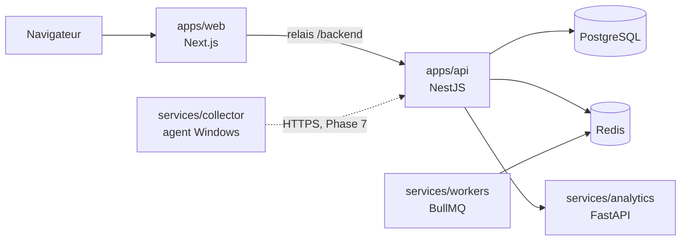

# Architecture

## Vue d'ensemble

Seul ce qui figure en trait plein existe aujourd'hui.

## Décisions

### Monorepo pnpm et Turborepo

Les paquets TypeScript sont en ESM, car NestJS 12 l'impose. Les services Python ont un `package.json` minimal : Turborepo les pilote ainsi comme les autres paquets, et `scripts/py.mjs` gère leur environnement virtuel.

### `packages/database`, ajouté à la structure du cahier des charges

L'API et les workers accèdent tous deux à la base. Le schéma Prisma, les migrations et le client sont donc dans un paquet partagé plutôt que dans `apps/api`.

### Relais `/backend` plutôt que réécritures Next.js

Les réécritures de `next.config` sont figées au build. Le relais lit `API_INTERNAL_URL` à l'exécution : une même image web sert en Cloud et en On-Premise. Le navigateur reste sur la même origine, ce qui prépare les cookies de session de la Phase 2.

### Configuration validée au démarrage

Les variables d'environnement sont validées par des schémas Zod de `packages/validation`. Un service mal configuré refuse de démarrer, et ses messages d'erreur ne reproduisent jamais les valeurs, qui peuvent contenir des secrets.

### Santé réelle plutôt que déclarative

`GET /health` interroge réellement chaque dépendance à chaque appel :

| Dépendance | Vérification                                                   | Critique |
| ---------- | -------------------------------------------------------------- | -------- |
| PostgreSQL | `SELECT 1`                                                     | Oui      |
| Redis      | `PING`                                                         | Oui      |
| Analytics  | `GET /health`                                                  | Non      |
| Workers    | Présence du heartbeat publié par une tâche BullMQ, TTL de 90 s | Non      |

Une dépendance critique absente donne `error` et HTTP 503. Une dépendance secondaire absente donne `degraded` et HTTP 200. Les messages publics ne contiennent jamais d'erreur de pilote, qui pourrait révéler un hôte ou une URL de connexion.

### Heartbeat des workers par tâche BullMQ

Le heartbeat est publié par une tâche planifiée et traitée dans la file `system`. Sa présence prouve toute la chaîne : Redis, le planificateur et le traitement. La clé expire seule, donc un worker arrêté est détecté sans signal d'arrêt.

### Versions fixées

| Paquet     | Version | Raison                                                                                    |
| ---------- | ------- | ----------------------------------------------------------------------------------------- |
| Node.js    | 24      | Prisma 7.10 ne supporte que les versions 20, 22 et 24                                     |
| TypeScript | 5.9     | `typescript-eslint` exige moins de 6.1 et `@nestjs/swagger` moins de 7                    |
| Prisma     | 7.10    | Le tag `latest` pointe sur une RC 8, et Better Auth accepte au plus Prisma 7              |
| pnpm       | 10      | Le paquet pnpm 12 installé par npm laisse un exécutable inutilisable sur cette machine    |
| ESLint     | 9       | Fonctionne avec toute la chaîne, mais npm la signale obsolète : passage à la 10 à prévoir |

## Authentification

Better Auth est monté dans l'API sur `/api/auth/*`, avant le parseur JSON de NestJS, car il lit lui-même le corps de ses requêtes. Le navigateur y accède par le relais `/backend` : la session est un cookie `HttpOnly` de première partie (`arksen.session_token`), jamais lisible par JavaScript.

| Règle                                    | Mise en œuvre                                                                              |
| ---------------------------------------- | ------------------------------------------------------------------------------------------ |
| Pas d'inscription libre                  | `disableSignUp` : les comptes sont créés par un administrateur                             |
| Mots de passe                            | 12 à 128 caractères (NIST SP 800-63B), hachés en scrypt par Better Auth                    |
| Durée de session                         | 12 heures, prolongée à l'usage par tranches d'une heure                                    |
| Force brute                              | 5 tentatives de connexion par minute et par adresse IP                                     |
| Origine                                  | Seule `PUBLIC_WEB_URL` est acceptée pour les requêtes d'authentification                   |
| Compte désactivé ou entreprise suspendue | Création de session refusée, sessions existantes supprimées, vérification à chaque requête |
| Champs sensibles                         | `role`, `status` et `tenantId` ne peuvent jamais être fournis par le client                |

Le premier Super Administrateur est créé au démarrage de l'API à partir de `SUPER_ADMIN_EMAIL` et `SUPER_ADMIN_PASSWORD`, uniquement si aucun n'existe.

## Contrôle d'accès

Deux gardes globaux s'appliquent à chaque route, sauf celles marquées `@Public()` (`/health`, `/api/v1/system/info`) :

1. **`AuthenticationGuard`** vérifie la session, puis relit le compte et son entreprise en base. Une désactivation prend donc effet à la requête suivante.
2. **`AuthorizationGuard`** applique deux règles :
   - **Périmètre :** sur toute route portant `:tenantId`, un utilisateur d'entreprise n'accède qu'à la sienne. Une autre entreprise répond 404, pour ne pas révéler son existence.
   - **Permissions :** le rôle doit détenir toutes celles déclarées par `@RequirePermissions()`.

La matrice des rôles est définie dans le code (`packages/shared-types/src/access.ts`), et non en base : une politique de sécurité modifiable à l'exécution serait une surface d'attaque sans besoin métier identifié. Chaque phase y ajoutera les permissions de ses modules.

| Permission                | Super Admin | Admin client | Resp. impression | Technicien | Gest. stock | Utilisateur |
| ------------------------- | :---------: | :----------: | :--------------: | :--------: | :---------: | :---------: |
| `platform:tenants:manage` |     Oui     |              |                  |            |             |             |
| `platform:audit:read`     |     Oui     |              |                  |            |             |             |
| `tenant:read`             |     Oui     |     Oui      |       Oui        |    Oui     |     Oui     |     Oui     |
| `users:read`              |     Oui     |     Oui      |       Oui        |            |             |             |
| `users:manage`            |     Oui     |     Oui      |                  |            |             |             |
| `audit:read`              |     Oui     |     Oui      |                  |            |             |             |

Un administrateur client ne peut ni attribuer le rôle Super Administrateur, ni modifier son propre rôle ou statut.

## Isolation multi-tenant

L'isolation repose sur trois couches indépendantes : une erreur dans l'une ne suffit pas à exposer les données d'une autre entreprise.

1. **API :** l'entreprise vient de la session ou d'un paramètre d'URL comparé à la session, jamais du corps de la requête. Un `tenantId` glissé dans un formulaire est ignoré.
2. **Requêtes :** chaque lecture filtre explicitement sur `tenantId`.
3. **PostgreSQL :** l'API se connecte avec deux rôles distincts, jamais avec le propriétaire de la base.

| Rôle PostgreSQL | Attribut      | Usage                                                                                           |
| --------------- | ------------- | ----------------------------------------------------------------------------------------------- |
| `arksen`        | propriétaire  | Migrations uniquement                                                                           |
| `arksen_app`    | `NOBYPASSRLS` | Données métier, toujours via `withTenant()`. Aucun droit sur les sessions ni les mots de passe  |
| `arksen_system` | `BYPASSRLS`   | Authentification, journal d'audit, opérations explicitement transverses du Super Administrateur |

`withTenant(prisma, tenantId, work)` ouvre une transaction et y définit `app.tenant_id` avec `SET LOCAL`. Les politiques RLS ne laissent voir et écrire que les lignes de cette entreprise. Sans contexte, le rôle métier ne voit **aucune** ligne. Le réglage disparaît avec la transaction : une connexion rendue au pool ne garde jamais le contexte d'une autre entreprise.

**Règle pour toute nouvelle table d'entreprise :** colonne `tenant_id`, politique `tenant_isolation` dans la migration, accès par `withTenant()`. Un test de bout en bout échoue si une table portant `tenant_id` n'a pas le RLS activé.

## Journal d'audit

Les événements sensibles sont enregistrés dans `audit_logs` : connexions réussies, échouées ou refusées, changements de mot de passe, créations et modifications d'entreprises et d'utilisateurs. Un déclencheur PostgreSQL interdit toute modification ou suppression, y compris pour les rôles applicatifs. Un échec d'écriture du journal est journalisé, mais n'interrompt jamais l'action de l'utilisateur.

La politique de conservation, et donc la purge des événements anciens, est à définir en Phase 10.

## Adresse IP des clients

Better Auth limite les tentatives par adresse IP, lue dans `X-Forwarded-For`. Seuls les proxys des réseaux privés et de la boucle locale sont crus, et la chaîne est lue de droite à gauche jusqu'au premier saut non fiable.

En développement, sans proxy frontal, un poste du réseau local peut fixer son propre `X-Forwarded-For`. En production, le proxy frontal (Nginx, Phase 10) doit écraser cet en-tête avec l'adresse réelle du client.

## Origine des données

`packages/shared-types` définit `DATA_ORIGINS` : `theoretical`, `measured`, `snmp_level`, `demo`. Chaque valeur de consommation portera son origine, pour ne jamais confondre un niveau SNMP, une mesure et un calcul.
